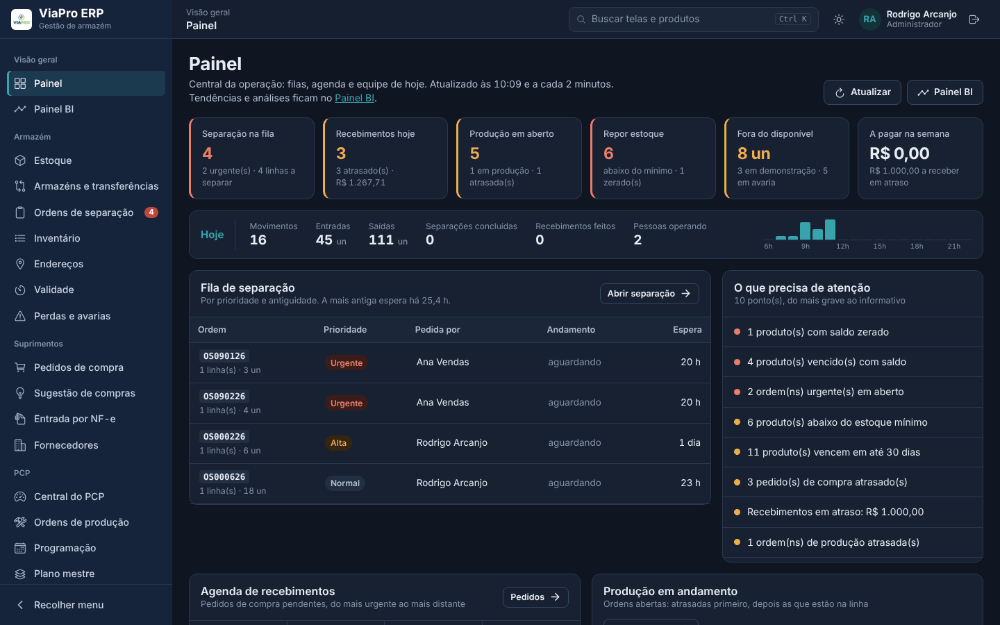
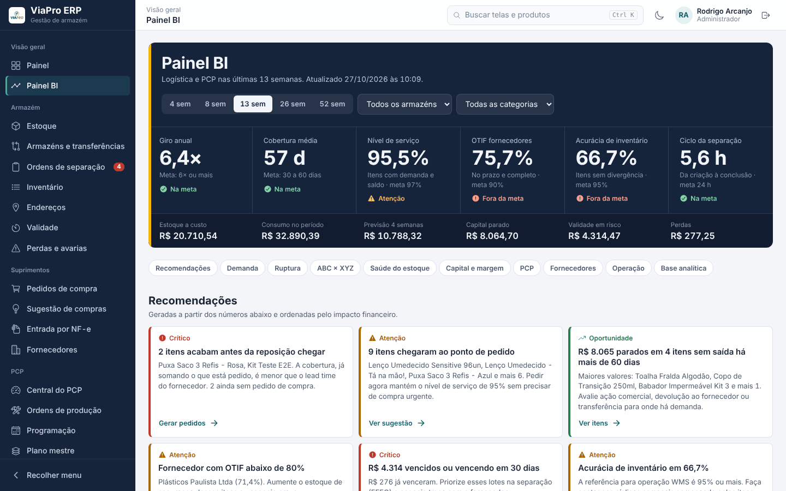
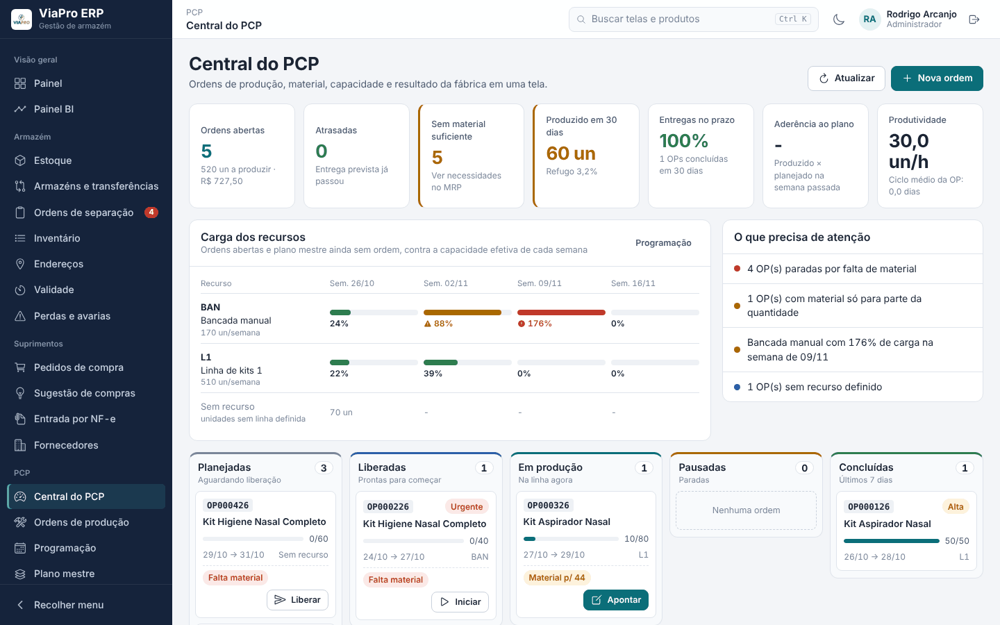
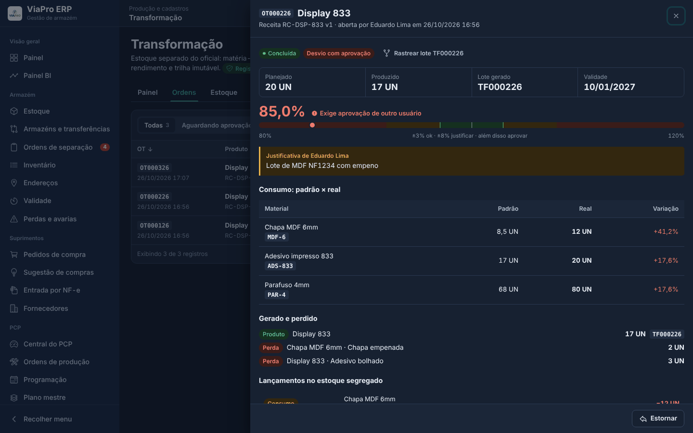
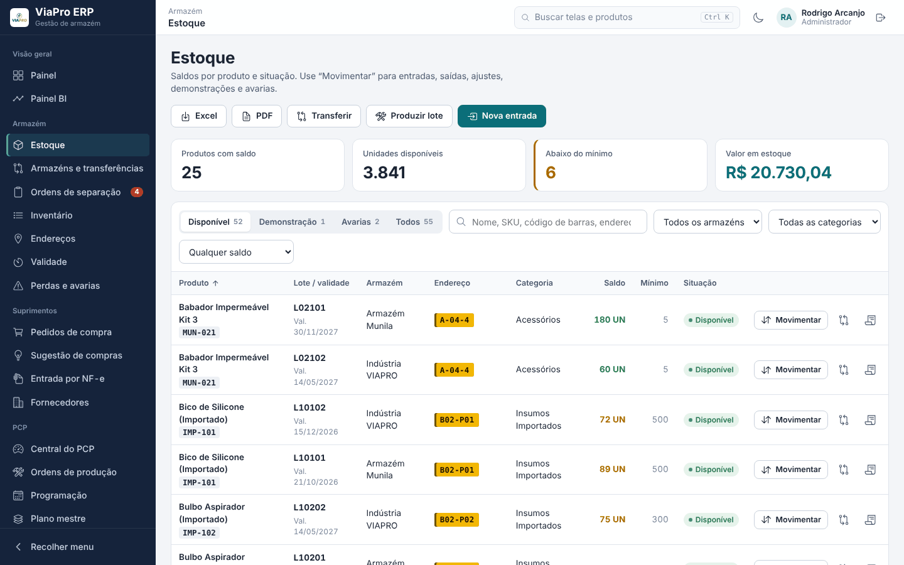
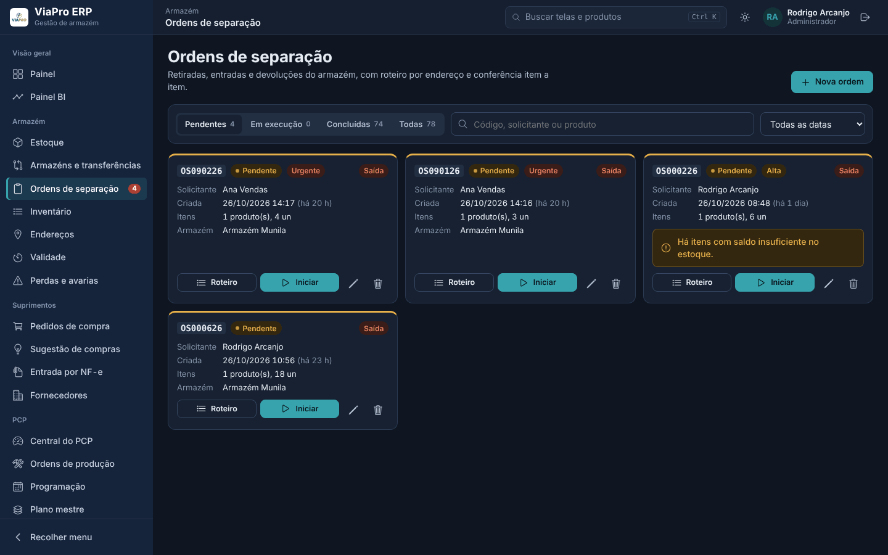
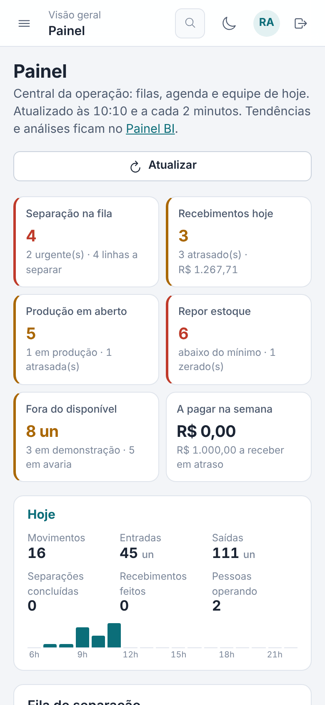
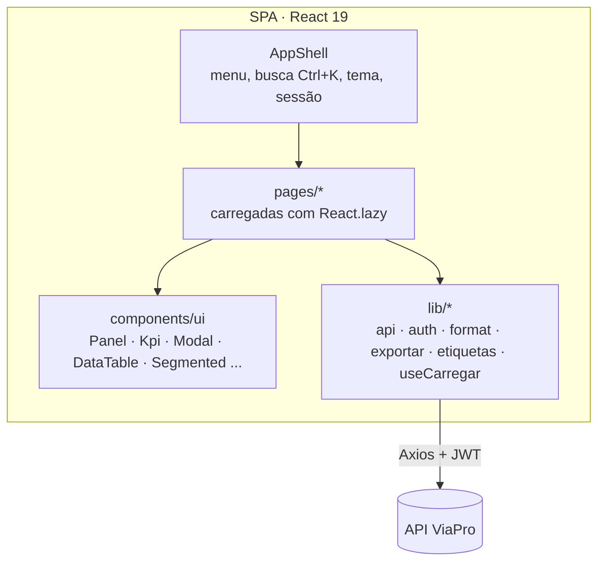

<div align="center">

# ViaPro ERP · Web

**Interface de um ERP de armazém: WMS, PCP, compras, financeiro, transformação auditável e BI logístico.**

Responsiva do monitor da gerência à tela do celular, com tema claro e escuro e busca global.


[Telas](#telas) · [Funcionalidades](#funcionalidades) · [Arquitetura](#arquitetura) · [Design system](#design-system) · [Como rodar](#como-rodar)

<br/>



</div>

---

## Sobre

O ViaPro substitui planilhas e o sistema legado de um distribuidor e montador de produtos. A gerência acompanha indicadores e decide. O armazém executa separação, inventário e recebimento. O PCP planeja e aponta a produção. Tudo sobre a mesma base, consumindo a [API ViaPro](https://github.com/rodrigoarcanjo23/munila-backend).

O projeto passou por um redesign completo, com design system próprio, telas carregadas sob demanda, layout responsivo e dark mode. Recebeu ainda módulos no nível de WMS e ERP de mercado: inventário cíclico, sugestão de compras, entrada por XML, PCP com MRP e BI logístico.

## Telas

<table>
  <tr>
    <td width="50%"><br/><b>Painel BI</b>: indicadores com meta, recomendações por impacto financeiro, previsão de demanda, ABC × XYZ, ruptura, fornecedores e capital e margem.</td>
    <td width="50%"><br/><b>Central do PCP</b>: ordens por etapa, carga dos recursos, falta de material e produção do mês.</td>
  </tr>
  <tr>
    <td><br/><b>Transformação</b>: rendimento contra a receita, consumo padrão × real, aprovação de desvio e trilha de auditoria com hash.</td>
    <td><br/><b>Estoque</b>: saldo por lote, armazém e endereço, com operações e leitura de código de barras.</td>
  </tr>
  <tr>
    <td><br/><b>Separação (WMS)</b>: fila por prioridade, picking FEFO e conferência por leitura.</td>
    <td align="center"><br/><b>Celular</b>: tabelas viram cartões, formulários em uma coluna e modais abrindo de baixo.</td>
  </tr>
</table>

## Funcionalidades

| Área | Telas | O que entrega |
|---|---|---|
| **Visão geral** | Painel · Painel BI | **Painel**: central da operação, atualizada a cada 2 min, com fila de separação, recebimentos do dia, produção, equipe, agenda financeira e qualidade do cadastro (cada pendência abre os produtos filtrados). **BI**: giro, cobertura, nível de serviço, OTIF, acurácia, previsão de Holt, ABC × XYZ, saúde do estoque, capital e margem. |
| **Armazém** | Estoque · Armazéns · Separação · Inventário · Endereços · Validade · Perdas | Saldo por lote e armazém, transferências, picking FEFO, inventário cíclico com contagem cega, etiquetas de endereço com código de barras, vencimentos em R$ |
| **Suprimentos** | Pedidos · Sugestão de compras · Entrada por NF-e · Fornecedores | Ponto de pedido com lead time e estoque de segurança, conferência cega, divergência, importação do XML com conversão de unidade |
| **PCP** | Central · Ordens · Programação · Plano mestre · MRP · Estruturas · Recursos | Ordens de produção com apontamento e refugo, programação por recurso, plano mestre a partir da previsão, MRP com data de necessidade e estrutura multinível com custo |
| **Produção e cadastros** | Produtos · Transformação · Curva ABC | Catálogo com dados fiscais, receitas de kit e estoque segregado de transformação: receitas versionadas, tolerância com aprovação de outro usuário, rastreio de lote e auditoria |
| **Gerencial** | Financeiro · Fluxo de caixa · Kardex · Histórico · Usuários · Empresa | Contas a pagar e receber com parcelamento, fluxo de caixa projetado, Kardex com saldo após cada lançamento |

**Em todo o sistema:**
- busca global com `Ctrl + K` (telas e produtos);
- exportação para Excel e PDF que respeita os filtros aplicados;
- impressão de etiquetas térmicas 50×30 ou A4;
- diálogos próprios no lugar de `alert`, `confirm` e `prompt`;
- controle de acesso por perfil (admin, estoque e vendas).

## Arquitetura



```
src/
├── App.tsx              # rotas (lazy) e guardas de perfil
├── components/
│   ├── AppShell.tsx     # layout, menu recolhível, busca global, troca de tema
│   ├── DataTable.tsx    # tabela ordenável e paginada que vira cartões no celular
│   ├── ui.tsx           # design system: Panel, Kpi, Badge, Modal/Drawer, Notice, diálogos
│   └── pcp/             # componentes compartilhados do PCP
├── lib/
│   ├── api.ts           # Axios com token, base URL configurável e mensagens de erro legíveis
│   ├── useCarregar.ts   # hook de carregamento com recarga silenciosa
│   ├── exportar.ts      # Excel (xlsx) e PDF (jsPDF + AutoTable) sob demanda
│   ├── etiquetas.ts     # código de barras (JsBarcode) para impressão térmica
│   └── format.ts        # moeda, número, datas no fuso de Brasília
├── pages/               # uma tela por arquivo; módulos grandes em subpastas (pcp/, transformacao/, bi/)
└── styles/global.css    # tokens, componentes e responsivo
```

**Princípios adotados:**
- **Regra de negócio no servidor.** O front não calcula saldo nem decide movimento. Ele só apresenta e coleta intenção. Por isso web e app sempre mostram o mesmo número.
- **Bibliotecas pesadas sob demanda.** `xlsx` e `jspdf` são importados só no clique de exportar, e cada tela é um chunk separado. O primeiro carregamento fica leve no celular.
- **Estado de URL quando faz sentido.** Abas, filtros e pendências ficam na query string (`/transformacao?aba=auditoria`, `/produtos?pendencia=ncm`), então dá para compartilhar o link de uma visão específica.
- **Gráficos que seguem o tema.** `useCores` lê os tokens CSS em tempo de execução, e o Recharts troca de paleta junto com o dark mode.

## Design system

| Token | Uso |
|---|---|
| Azul-marinho `#15233b` | Menu lateral e superfícies de destaque |
| Petróleo `#0b6e79` | Ação primária, links, séries principais |
| Amarelo etiqueta `#f2b705` | Endereço de prateleira, sempre no formato de etiqueta física |
| `--ok` · `--warn` · `--bad` | Status reservados, sempre acompanhados de texto ou ícone |
| IBM Plex Sans / Condensed / Mono | Texto, números de destaque e códigos (SKU, lote, OT) |

Breakpoints: **≥ 1024 px** desktop · **720–1023 px** tablet (menu vira gaveta) · **< 720 px** celular (tabelas em cartões, modais tipo *bottom sheet*).

## Como rodar

**Requisitos:** Node.js 20+ e a [API](https://github.com/rodrigoarcanjo23/munila-backend) rodando.

```bash
git clone https://github.com/rodrigoarcanjo23/munila-frontend.git
cd munila-frontend
npm install
cp .env.example .env     # VITE_API_URL=http://localhost:3333
npm run dev              # http://localhost:5173
```

| Variável | Descrição |
|---|---|
| `VITE_API_URL` | Endereço da API. Sem ela, o app usa a API de produção. |

| Script | Faz |
|---|---|
| `npm run dev` | Servidor de desenvolvimento com HMR |
| `npm run build` | Build de produção em `dist/` |
| `npm run preview` | Serve a build localmente |
| `npm run lint` | ESLint (inclui as regras de hooks do React) |

### Deploy (Vercel)

O `vercel.json` reescreve todas as rotas para `index.html` (SPA). Basta importar o repositório na Vercel e definir `VITE_API_URL`. Publique sempre a API antes do front.

## Roadmap

- [ ] Pedido de venda com reserva de estoque
- [ ] Emissão de NF-e a partir do pedido
- [ ] Metas configuráveis no Painel BI
- [ ] Testes de componentes e E2E no CI

---

<div align="center">
Desenvolvido por <a href="https://github.com/rodrigoarcanjo23">Rodrigo Arcanjo</a>
</div>
